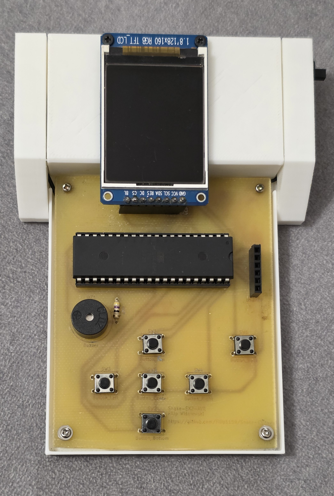
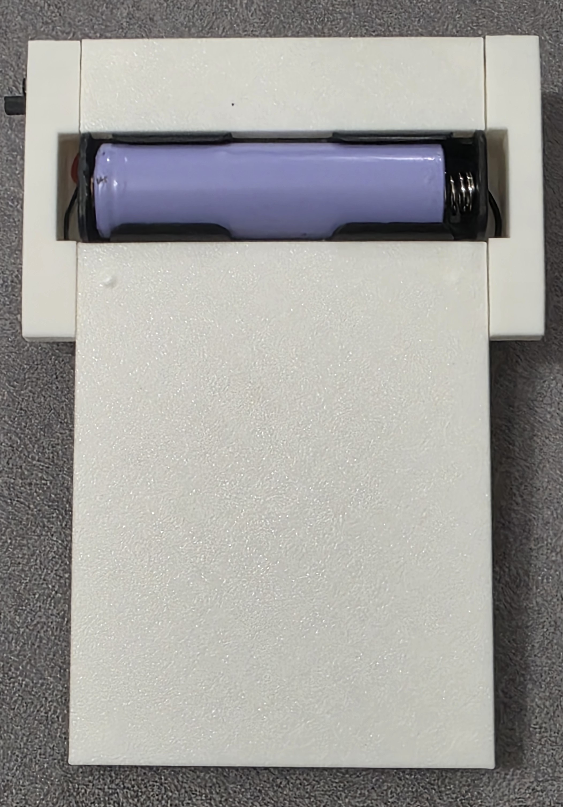
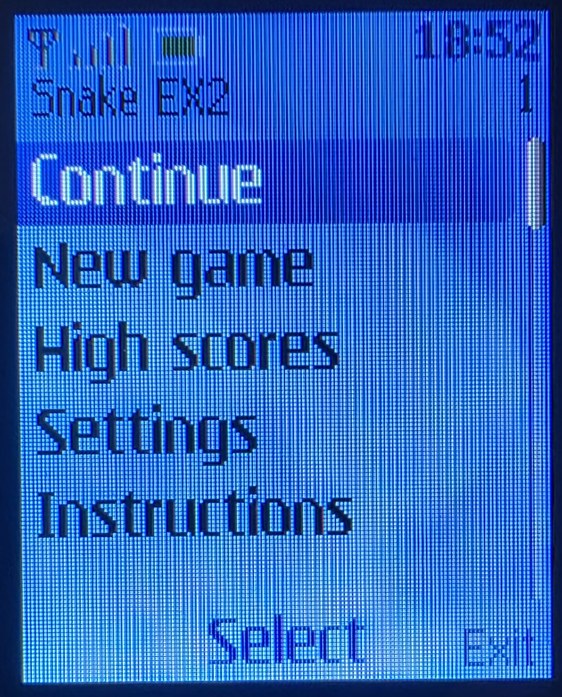
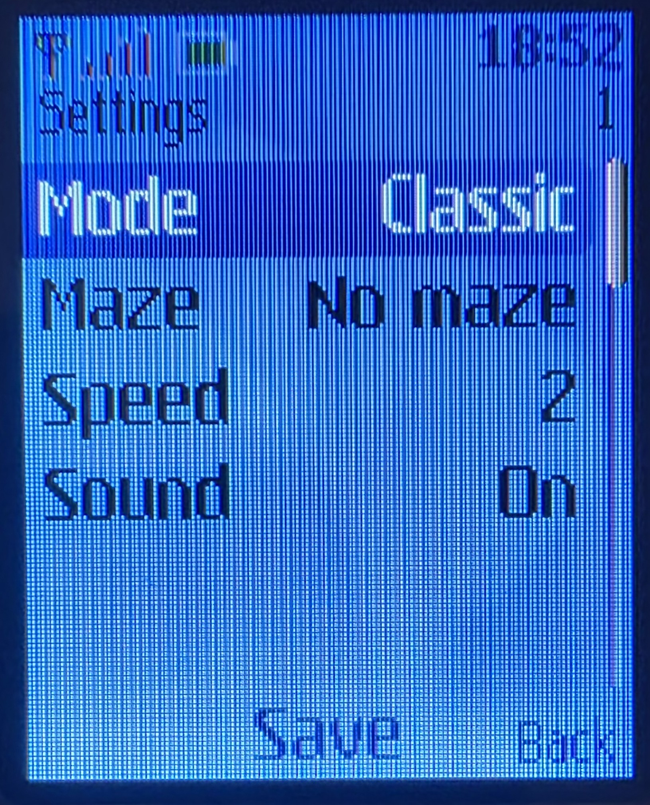
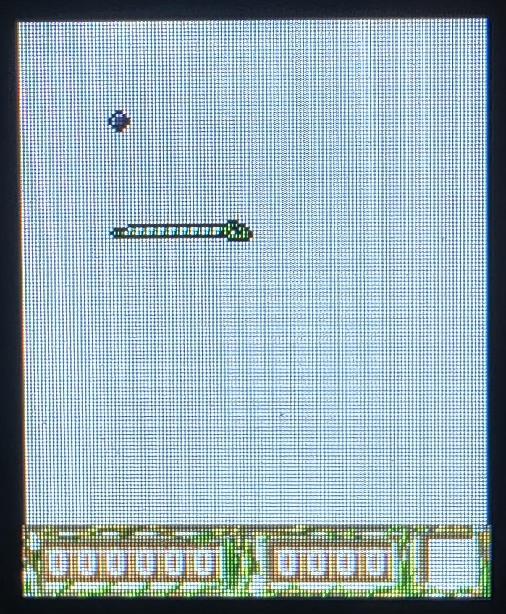
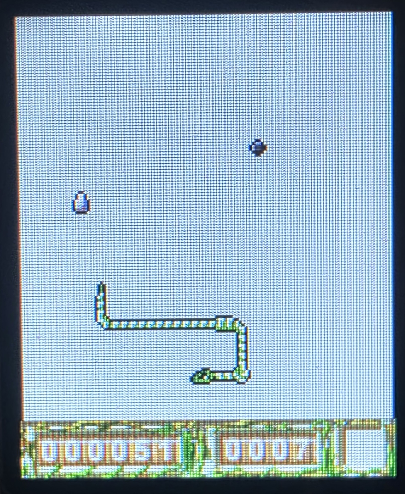
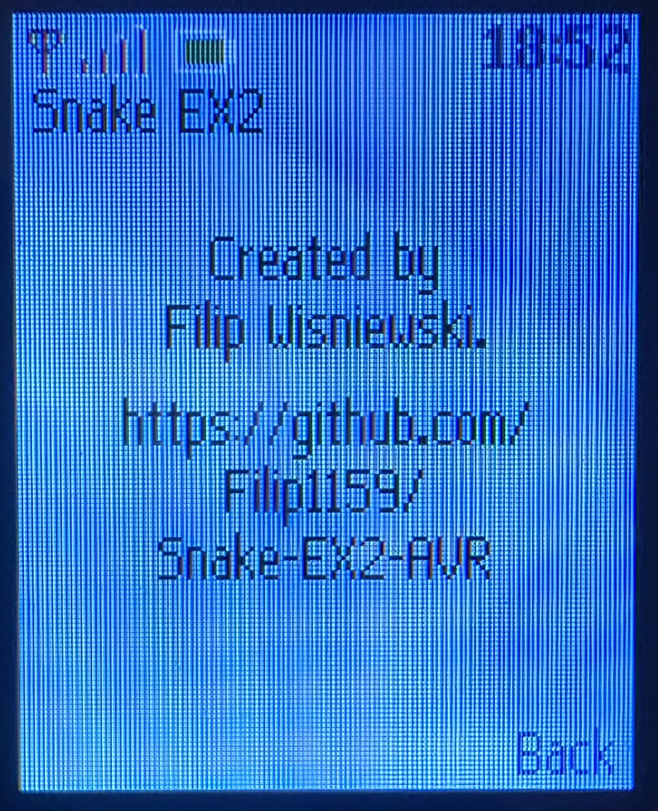

# Snake EX2 — ATmega644PA hardware port

A standalone port of Nokia's **Snake EX2** (Nokia 3300, 2003, MIDlet v1.19) to an ATmega644PA, an
ST7735 128×160 SPI LCD and six buttons, powered by a single Li-ion cell. The game logic, mazes,
sprites, HUD, sounds, menus and Extreme-mode progression were reconstructed from the decompiled
MIDlet; the port keeps the original 15 fps movement cadence, edge wrapping, power-ups,
portal/shrink cycle, high-score table and sound effects, wrapped in a Series 40 style menu.


<table>
  <tr>
    <td width="50%"></td>
    <td width="50%"></td>
  </tr>
  <tr>
    <td align="center"><sub>The board: ATmega644PA, LCD, buzzer and six buttons</sub></td>
    <td align="center"><sub>Back of the 3D-printed case with the Li-ion cell</sub></td>
  </tr>
  <tr>
    <td width="50%"></td>
    <td width="50%"></td>
  </tr>
  <tr>
    <td align="center"><sub>Main menu, with the battery level in the status bar</sub></td>
    <td align="center"><sub>Settings: mode, maze, speed, sound</sub></td>
  </tr>
  <tr>
    <td width="50%"></td>
    <td width="50%"></td>
  </tr>
  <tr>
    <td align="center"><sub>Game start</sub></td>
    <td align="center"><sub>Game in progress</sub></td>
  </tr>
  <tr>
    <td width="50%"></td>
    <td></td>
  </tr>
  <tr>
    <td align="center"><sub>Credits</sub></td>
    <td></td>
  </tr>
</table>

## Features

- Classic mode (6 mazes × 6 speeds) and the endless Extreme campaign with power-ups, portal and
  maze cycling.
- Pause saves the game to EEPROM; "Continue" restores it. Settings and high scores (top 3 per
  mode) are stored in EEPROM too.
- All 13 original sound effects on a buzzer (active by default, passive piezo supported).
- Battery gauge in the status bar: the supply voltage is measured against the internal 1.1 V
  reference, and the icon turns red below 20 %.

## Hardware

| Part | Notes |
|------|-------|
| ATmega644PA-PU | DIP-40, internal 8 MHz RC, 64 KB flash / 4 KB SRAM / 1 KB EEPROM |
| 1.8" ST7735 128×160 SPI LCD | 8-pin module, logic pins wired straight to the MCU |
| 6 tactile buttons | PA0–PA5, active low, internal pull-ups |
| Buzzer | PD6 through a 47 Ω resistor |
| 1× Li-ion cell | Powers the MCU and LCD directly (no regulator) |
| USBasp | 6-pin ISP header |

The KiCad project is in [`snake-ex2-avr-kicad.zip`](snake-ex2-avr-kicad.zip); the case is in
[`snake-avr-game.f3d`](snake-avr-game.f3d) (Fusion 360), with `.stl` and `.3mf` exports for
printing. Pin table, power notes and fuses: [`docs/hardware.md`](docs/hardware.md).

## Build and flash

```sh
pio run -e ATmega644PA             # build   (or: make firmware)
pio run -e ATmega644PA -t upload   # flash with USBasp   (or: make upload)
make test                          # host tests
```

Generated asset tables are checked in, so a clean checkout builds without the original game
files. Fuses, EEPROM and recovery: [`docs/build.md`](docs/build.md).

## Controls

| Button | Game | Menus |
|--------|------|-------|
| Up / Down / Left / Right | Steer the snake | Navigate |
| Fire | Tongue | Select / confirm |
| Pause | Save and return to the menu | Back |
